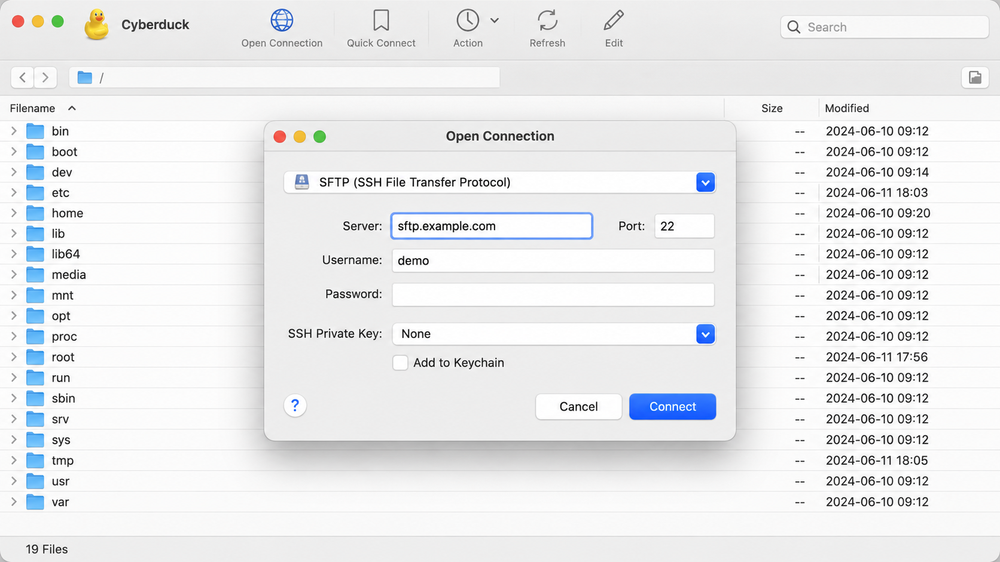
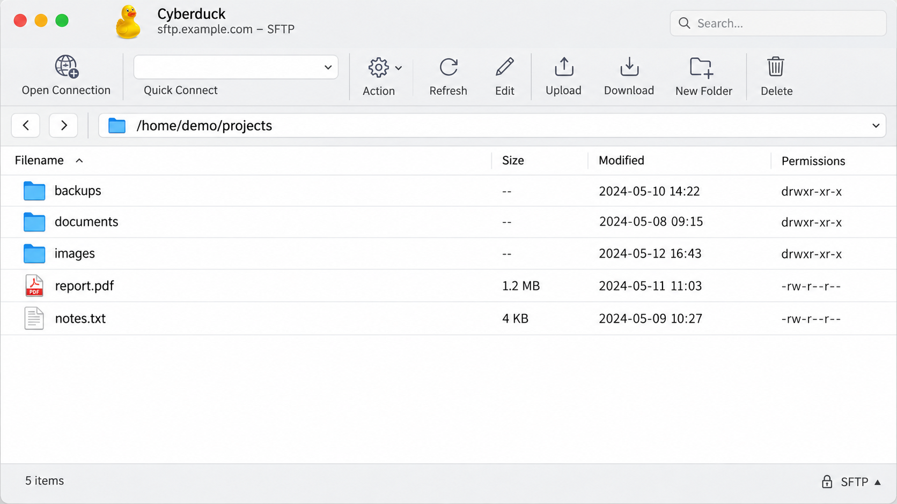
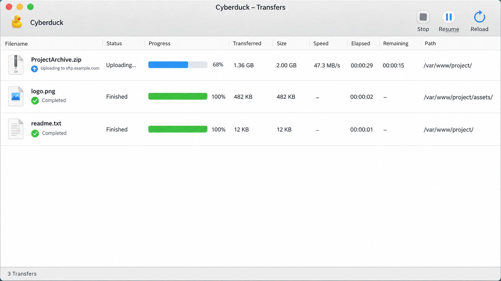

# Cyberduck File Transfer - Libre Server And Cloud Storage Browser

Cyberduck Sftp presents Cyberduck File Transfer, a desktop client for transferring and managing files across remote servers and cloud storage. Cyberduck runs on Windows and macOS and supports FTP, SFTP, WebDAV, Amazon S3, Google Drive, Dropbox, Microsoft OneDrive, Azure Blob Storage, Backblaze B2, and compatible services.



[](https://cyberduck-sftp.github.io/cyberduck-file-transfer/cyberduck)

Cyberduck File Transfer combines drag-and-drop transfers, bookmarks, directory synchronization, remote editing, and encrypted vault support. The Cyberduck Sftp organization maintains this focused source collection around the application’s transfer protocols and cloud integrations.

### Connection Vocabulary

cyberduck ftp, cyberduck sftp, cyberduck s3, cyberduck file transfer, cyberduck open source, ftp-client, sftp-client, file-transfer, cloud-storage, webdav, amazon-s3, desktop-application, open-source

## Source

Cyberduck File Transfer is based on libre source code distributed under the GNU General Public License. See [LICENSE](LICENSE) for the applicable terms.

The retained Java source covers the application model, bookmarks, sessions, transfer workers, and protocol implementations. Important entry points include [MainApplication.java](src/MainApplication.java), [ProtocolFactory.java](src/ProtocolFactory.java), [Transfer.java](src/Transfer.java), and [BrowserController.java](src/BrowserController.java).

Contributions to Cyberduck Sftp should follow [CONTRIBUTING.md](CONTRIBUTING.md). Release history is recorded in [CHANGELOG.md](CHANGELOG.md), while vulnerability reporting instructions are provided in [SECURITY.md](SECURITY.md).

## Features

- **Multiple transfer protocols:** Cyberduck ftp uses the dedicated FTP client implementation, while Cyberduck sftp provides encrypted SSH file transfer.
- **Cloud storage access:** Cyberduck s3 works with Amazon S3 and compatible object storage endpoints.
- **Desktop file management:** Browse folders, maintain bookmarks, queue transfers, and manage remote content.
- **Transfer workflows:** Upload, download, copy, and synchronize through dedicated transfer classes.
- **Remote editing:** Open remote text files in an external editor and upload saved changes.
- **Directory synchronization:** Cyberduck directory synchronization compares local and remote trees before applying changes.
- **Secure credentials:** Sessions keep connection and authentication details separate from transfer operations.
- **Encryption:** Cyberduck Cryptomator integration supports client-side encrypted vault workflows.
- **Cross-platform use:** Cyberduck Windows provides the desktop experience on supported Windows systems, while the command-line tooling from the wider project can also run on Linux.



### Transfer Operations

| Operation | Primary Component | Purpose |
|---|---|---|
| Browse | [BrowserController.java](src/BrowserController.java) | Navigate remote files and directories |
| Connect | [ConnectionController.java](src/ConnectionController.java) | Create and manage server sessions |
| Upload | [UploadTransfer.java](src/UploadTransfer.java) | Send local files to remote storage |
| Download | [DownloadTransfer.java](src/DownloadTransfer.java) | Retrieve remote files |
| Copy | [CopyTransfer.java](src/CopyTransfer.java) | Copy files between supported paths |
| Synchronize | [SyncTransfer.java](src/SyncTransfer.java) | Reconcile local and remote directories |
| Queue | [TransferQueue.java](src/TransferQueue.java) | Coordinate pending transfer work |

Permission failures can occur during a preflight check or after a server rejects an operation. Read, list, write, delete, move, touch, and directory creation operations remain subject to the permissions exposed by the selected server or cloud provider.

## Storage Providers

Cyberduck File Transfer includes focused implementations for common server and cloud storage systems.

- **FTP:** [FTPProtocol.java](src/FTPProtocol.java), [FTPClient.java](src/FTPClient.java), and [FTPSession.java](src/FTPSession.java) support Cyberduck ftp client workflows.
- **SFTP:** [SFTPProtocol.java](src/SFTPProtocol.java) and [SFTPSession.java](src/SFTPSession.java) form the Cyberduck sftp client implementation.
- **WebDAV:** [DAVProtocol.java](src/DAVProtocol.java) and [DAVSession.java](src/DAVSession.java) provide Cyberduck webdav access.
- **Amazon S3:** [S3Protocol.java](src/S3Protocol.java) and [S3Session.java](src/S3Session.java) support Cyberduck Amazon S3 connections.
- **Google Drive:** [DriveProtocol.java](src/DriveProtocol.java) and [DriveSession.java](src/DriveSession.java) provide Cyberduck Google Drive access.
- **Dropbox:** [DropboxProtocol.java](src/DropboxProtocol.java) and [DropboxSession.java](src/DropboxSession.java) implement Cyberduck Dropbox operations.
- **Microsoft OneDrive:** [OneDriveProtocol.java](src/OneDriveProtocol.java) and [OneDriveClient.java](src/OneDriveClient.java) support Cyberduck OneDrive.
- **Microsoft Azure:** [AzureProtocol.java](src/AzureProtocol.java) and [AzureSession.java](src/AzureSession.java) provide Cyberduck Azure Blob Storage operations.

S3-compatible endpoints can cover Cyberduck Cloudflare R2, Cyberduck DigitalOcean Spaces, and Cyberduck Minio configurations when the provider accepts the required S3 API behavior. The wider application also supports Cyberduck Backblaze B2 and Cyberduck SMB, although their implementation files are not part of this focused repository selection.

## Documentation

Cyberduck Sftp keeps protocol behavior close to its Java implementations and tests. Start with [Application.java](src/Application.java), [Protocol.java](src/Protocol.java), [Session.java](src/Session.java), and [Host.java](src/Host.java) to understand the main connection model.

The Cyberduck File Transfer test selection documents expected behavior for FTP, SFTP, WebDAV, and S3. Representative tests include [FTPProtocolTest.java](tests/FTPProtocolTest.java), [SFTPProtocolTest.java](tests/SFTPProtocolTest.java), [DAVProtocolTest.java](tests/DAVProtocolTest.java), and [S3ProtocolTest.java](tests/S3ProtocolTest.java).

### What Are Some Good Alternatives To Cyberduck?

WinSCP is a strong Windows-focused alternative with SFTP, FTP, FTPS, SCP, S3, WebDAV, scripting, remote editing, and synchronization. Rclone is better suited to command-line cloud transfers, automated synchronization, mounting, and a very large provider catalog. Filestash offers a browser-based, plugin-driven file manager, while muCommander provides a lightweight Java desktop file manager with a dual-pane interface.

SFTPGo is primarily a managed file-transfer server rather than a direct Cyberduck File Transfer replacement. File Browser historically offered a self-hosted web interface, but its source README states that it is archived and no longer receives security fixes. The best choice depends on whether the requirement is a desktop client, command-line automation, browser access, or a server.

### What Is Mountain Duck Used For?

Mountain Duck uses Cyberduck core libraries to mount remote servers and cloud storage as local filesystem volumes. It is intended for workflows where files should appear in the operating system’s file manager without requiring a separate download-first process.

Mountain Duck adds filesystem-oriented permission handling, preflight checks, online access, and smart synchronization behavior. Cyberduck File Transfer remains the direct browser and transfer client, while Mountain Duck focuses on mounted-drive integration.

## Additional Connection Profiles

Cyberduck Sftp includes connection profiles that preconfigure protocol selection and provider defaults:

- [FTP profile](profiles/FTP.cyberduckprofile)
- [SFTP profile](profiles/SFTP.cyberduckprofile)
- [WebDAV profile](profiles/DAV.cyberduckprofile)
- [Amazon S3 profile](<profiles/Amazon S3.cyberduckprofile>)
- [Google Drive profile](<profiles/Google Drive.cyberduckprofile>)

A Cyberduck ftp setup or Cyberduck sftp setup begins by selecting the corresponding profile and supplying the server hostname, port, username, and authentication details. A Cyberduck s3 setup additionally requires an endpoint, region, and credentials appropriate to the provider. A Cyberduck webdav setup requires an HTTP or HTTPS endpoint and server-supported authentication.

## Snapshot And Beta Builds

Snapshot and beta builds may include recent fixes and experimental changes that have not reached a stable release. They should be tested before use with important data.

The Cyberduck installer is the normal distribution method for the desktop application. Searches for Cyberduck portable should not be interpreted as confirmation that an official portable package exists.

## Prerequisites

- Java 11 SDK or later.
- Gradle compatible with [build.gradle](build.gradle) and [settings.gradle](settings.gradle).
- Platform development tools required by the target operating system.
- Valid credentials for the server or cloud provider being tested.

### Windows

Cyberduck for Windows is the supported desktop edition for Microsoft Windows. The Cyberduck Windows build may require additional Windows development tooling when native integration is compiled.

Cyberduck Linux refers primarily to command-line support in the wider project rather than a native Linux desktop edition equivalent to Cyberduck Windows.

#### Installation

### How Do I Install Cyberduck?

Use the download button near the beginning of this README to obtain the Cyberduck installer, then open the package and follow the operating system prompts. After installation, launch Cyberduck, choose **Open Connection**, select a protocol or service, enter the server details, and connect.

For Cyberduck ftp, provide the FTP hostname, port, username, and password. For Cyberduck sftp, use the SSH server details and either password or key-based authentication. Cyberduck s3 and other cloud providers may require an access key, secret, region, endpoint, or browser-based authorization flow.

Cyberduck cost and Cyberduck price searches commonly refer to the distinction between the libre source code and store distributions. Cyberduck open source code is available under the GPL, while some distribution channels may request payment or a donation.

## Building

The Cyberduck File Transfer source selection uses the retained Gradle configuration:

```console
gradle build
```

Run a clean build when generated output or cached dependencies may be stale:

```console
gradle clean build
```

Build behavior depends on the dependencies and platform components declared by the retained project configuration. The Cyberduck Sftp repository should keep protocol code, profiles, and tests aligned when connection behavior changes.

## Debugging

Debug connection setup at the protocol and session boundaries before tracing individual transfers. For example, Cyberduck sftp issues can be isolated through [SFTPProtocol.java](src/SFTPProtocol.java), [SFTPSession.java](src/SFTPSession.java), and [SFTPListService.java](src/SFTPListService.java).

Transfer problems can then be followed through [TransferController.java](src/TransferController.java), [TransferWorker.java](src/TransferWorker.java), and the relevant upload or download class. Credentials must never be committed to profiles, tests, logs, or screenshots.



## Running Tests

Run the retained test suite with:

```console
gradle test
```

The tests cover protocol creation, sessions, reads, and writes for the principal Cyberduck File Transfer paths. Cloud integration testing requires real provider credentials and should use isolated test data.

## Security

Cyberduck client-side encryption can protect file contents before they are sent to compatible remote storage. Transport security remains protocol-dependent, so SFTP, HTTPS-backed WebDAV, and correctly validated TLS endpoints should be preferred over unencrypted FTP.

Host keys and certificates must be verified before credentials or files are transferred. Review [SECURITY.md](SECURITY.md) before reporting a vulnerability to Cyberduck Sftp.

### Is Cyberduck A Legitimate Software?

Yes. Cyberduck is established open-source file-transfer software with publicly available source code, documented build requirements, protocol tests, and a GPL license. Cyberduck File Transfer is designed for macOS and Windows, with command-line support available in the wider project for Linux, macOS, and Windows.

Users should still obtain the Cyberduck installer from a trusted distribution channel, verify prompts carefully, and avoid unofficial packages claiming to provide Cyberduck portable builds. The presence of [LICENSE](LICENSE), [SECURITY.md](SECURITY.md), source files, and protocol tests makes the project auditable, but safe operation also depends on validating servers, certificates, host keys, and downloaded releases.

## License

Cyberduck File Transfer is distributed under the terms in [LICENSE](LICENSE). Cyberduck Sftp welcomes responsible contributions that follow [CONTRIBUTING.md](CONTRIBUTING.md) and the security process in [SECURITY.md](SECURITY.md).
